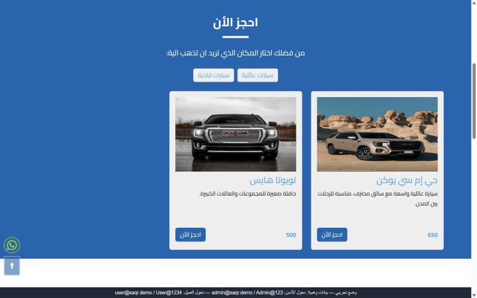
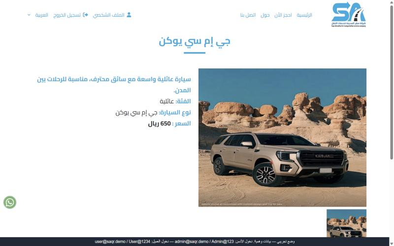
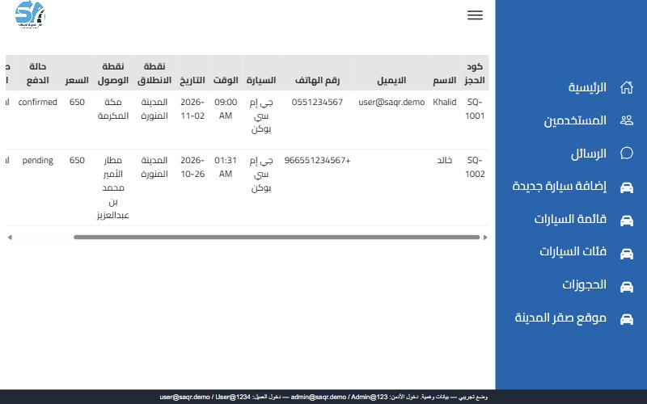
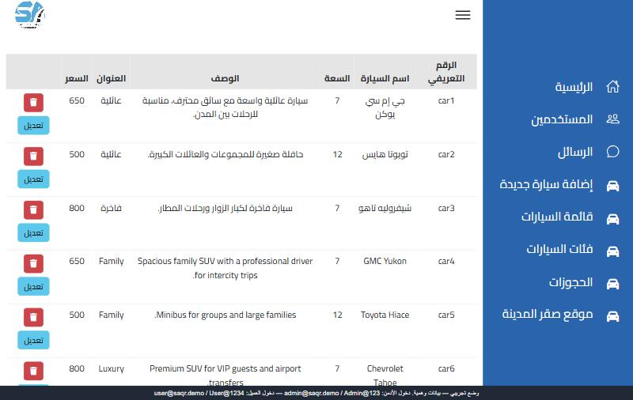

# Saqr Al-Madina — Car Rental & Transport Booking

<div dir="rtl">

موقع وحجز إلكتروني لشركة **صقر المدينة لخدمات النقل** في المدينة المنورة: تصفح السيارات حسب الفئة، الحجز، اختيار طريقة الدفع، ملف شخصي للعميل بحجوزاته، ولوحة تحكم للإدارة (السيارات، الفئات، الحجوزات، المستخدمين، الرسائل) — بالعربي والإنجليزي.

</div>

A bilingual (Arabic / English) booking website for **Saqr Al-Madina Transport Services**. Customers browse cars by category, book a trip, choose a payment method and follow their bookings; the admin dashboard manages cars, categories, bookings, users and contact messages, with Excel/CSV export.


| Booking | Car details |
|---|---|
|  |  |

| Admin — bookings | Admin — cars |
|---|---|
|  |  |

## Features

**Customers**
- Browse cars by category, with photos, capacity and price.
- Book a trip (pick-up and drop-off points), then pay by bank transfer or on arrival.
- Register, log in, reset a forgotten password, upload a profile photo and see all bookings.
- Arabic / English switch with right-to-left layout.

**Admin dashboard**
- Add, edit and delete cars (with multiple photos) and categories in both languages.
- Manage bookings and their status, users and contact-form messages.
- Export bookings and users to a spreadsheet.

## Run it

It is a static site — serve the folder with any web server:

```bash
python -m http.server 8080
```

Then open http://localhost:8080. The site starts in **demo mode**: `js/demo-api.js` answers every API call in the browser with sample data, so everything works without a backend.

| Role | Email | Password |
|---|---|---|
| Admin | `admin@saqr.demo` | `Admin@123` |
| Customer | `user@saqr.demo` | `User@1234` |

To connect a real backend, set `window.API_URL` in [`js/config.js`](js/config.js).

## Project structure

```
index.html, Car.html, payment.html, profile.html, login.html, …   Customer pages
dashboard.html, Dashboard/                                         Admin dashboard
js/config.js        API URL and site root
js/demo-api.js      In-browser demo backend
js/transilations/   Arabic / English texts per page
JSON/               Translation strings
Assets/             Images, logo and videos
```

## Author

**Renad Madi** — [IT.RENADMADI](https://github.com/RENAD-MADI)
